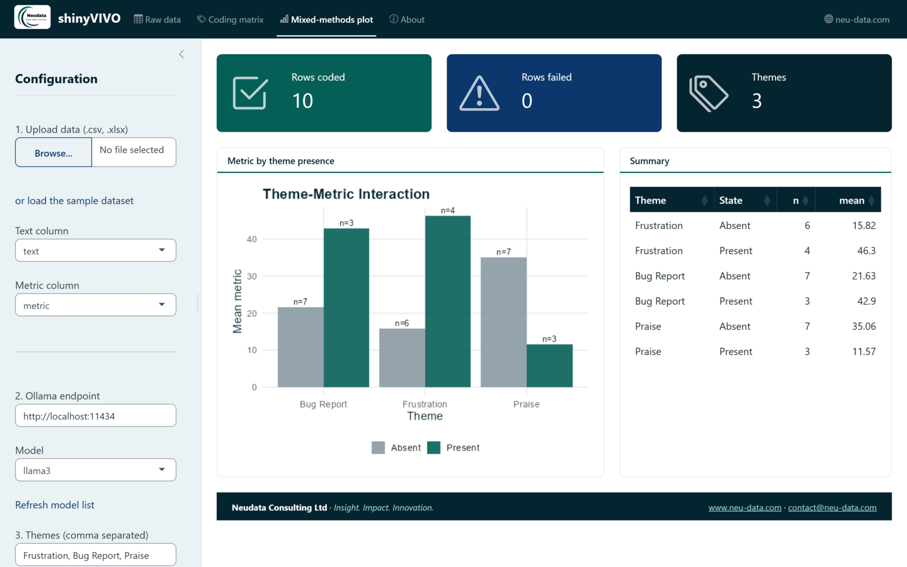

<div align="center">


</div>

# shinyVIVO 

<!-- badges: start -->
[](https://github.com/neu-data/shinyVIVO/actions/workflows/R-CMD-check.yaml)
[](https://neu-data.github.io/shinyVIVO/)
[](https://lifecycle.r-lib.org/articles/stages.html#experimental)

<!-- badges: end -->

**A point-and-click mixed-methods coding workbench with local AI.**

shinyVIVO lets researchers code qualitative text and link it to
quantitative data without writing code. Upload a spreadsheet, code the
text against your themes with a large language model running locally in
[Ollama](https://ollama.com), and see how a metric differs between texts
with and without each theme.

Because the model runs on your own machine, transcripts are never uploaded
to a cloud API. That matters for health, corporate and academic data that
ethics approvals or data agreements keep in-house.

```
spreadsheet ──► local LLM (Ollama) ──► coding matrix ──► metric by theme
 .csv / .xlsx    one call per row       TRUE / FALSE / NA   plot + summary
```

## Installation

shinyVIVO is not on CRAN yet. Install the development version from GitHub:

``` r
# install.packages("remotes")
remotes::install_github("neu-data/shinyVIVO")
```

Then install [Ollama](https://ollama.com) and pull a model:

```
ollama pull llama3
```

## Launch the workbench

``` r
shinyVIVO::launch_app()
```



1. Upload a `.csv` or `.xlsx` file, or click **load the sample dataset**.
2. Pick the text column and a numeric metric column.
3. Choose the model and type your themes, separated by commas.
4. Click **Run local AI coding**.

| Tab | Shows |
|---|---|
| Raw data | The uploaded dataset |
| Coding matrix | One `TRUE`/`FALSE` column per theme, `NA` where the model call failed; downloadable as CSV |
| Mixed-methods plot | Rows coded and failed, plus the mean metric with and without each theme, with group sizes |

## From code

Everything the app does is also available as functions:

``` r
library(shinyVIVO)

themes <- c("Frustration", "Bug Report", "Praise")
coded <- code_dataframe(vivo_sample_data(), text_col = "text",
                        themes = themes, model = "llama3")

summarise_theme_metric(coded, themes, "metric")
plot_theme_metric(coded, themes, "metric")
```

`ollama_code_text()` sends Ollama a JSON schema that requires one boolean
per theme, so the answers parse reliably, and runs at temperature 0 so they
are repeatable.

## Functions

| Function | Purpose |
|---|---|
| `launch_app()` | Open the point-and-click workbench |
| `ollama_code_text()` | Code one text against a set of themes with a local model |
| `code_dataframe()` | Code every row of a data frame (or use a custom coder) |
| `ollama_models()` | List the models available on an Ollama server |
| `summarise_theme_metric()` | Mean metric and group size with and without each theme |
| `plot_theme_metric()` | Plot the metric by theme presence in Neudata colours |
| `vivo_sample_data()` | Ten feedback comments with a session-length metric |

## Good practice

- **Validate first.** Have a person code a sample of the texts and check
  the model agrees before reporting results. For kappa, precision and
  recall against a human coder, see
  [llmCoder](https://github.com/neu-data/llmCoder)'s `code_agreement()`.
- **Treat results as associations.** A theme that goes with longer
  sessions does not cause them.
- **Pin the model.** Record the exact model name and version, since coding
  can change between model releases.

## Related Neudata packages

- [llmCoder](https://github.com/neu-data/llmCoder) codes text with any LLM
  from code, validates it against human coders and tests themes against
  metrics.
- [quant2qual](https://github.com/neu-data/quant2qual) goes the other way,
  turning behavioural metrics into qualitative case-study prose.

## License

MIT © Neudata Consulting Ltd

---

<div align="center">
<strong>Neudata Consulting Ltd</strong> · <em>Insight. Impact. Innovation.</em><br />
<a href="https://www.neu-data.com">www.neu-data.com</a> · <a href="mailto:contact@neu-data.com">contact@neu-data.com</a>
</div>
